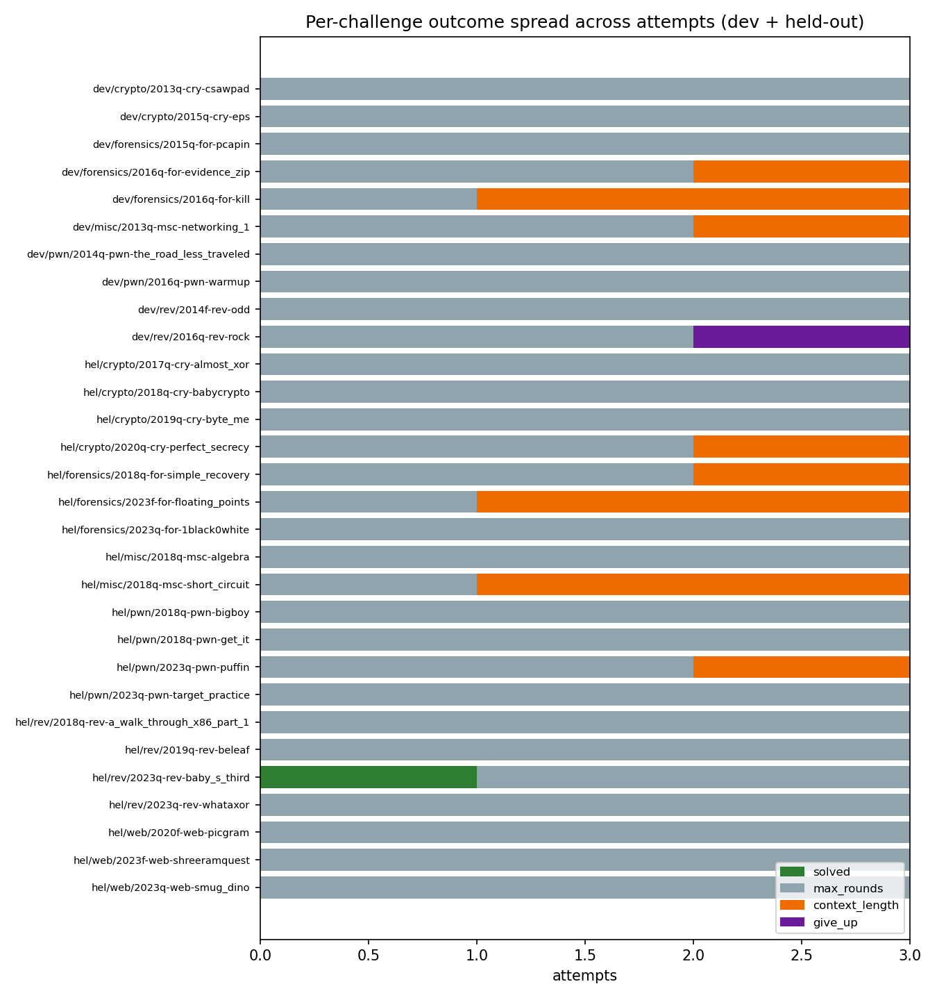
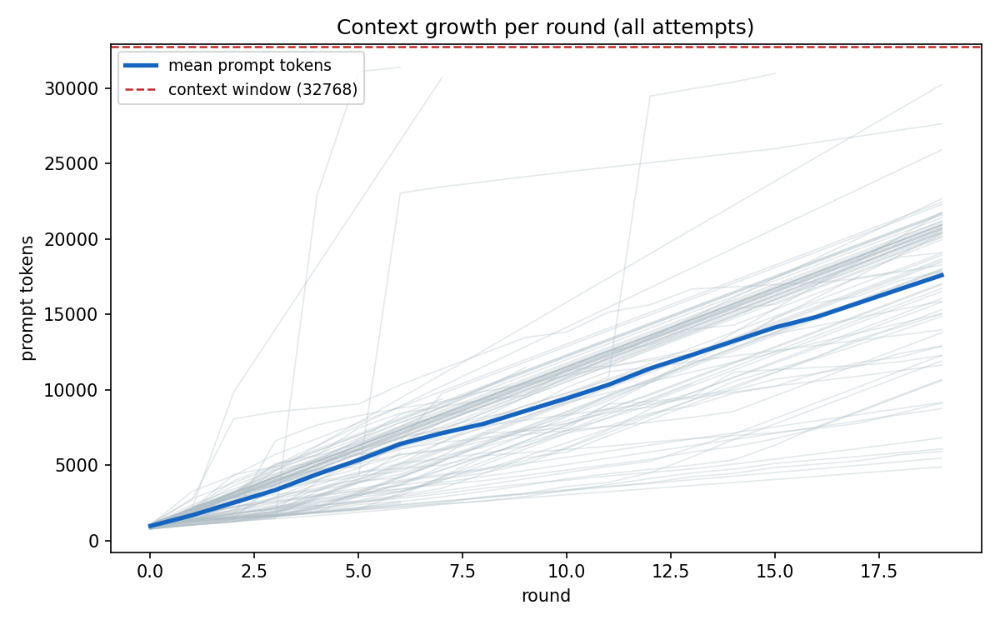

<!--
Phase 1 report DRAFT. Main body (§1-5) kept under 2 pages; figures, full metric
tables, and reproduction details live in the appendix.
Numbers from: results/phase1/{by_set,by_category,attempts,tool_calls}.csv;
analysis/score.py over logs/phase1; cross-validation from a parallel harness-hardening effort.
TODO before submission: confirm final commit hash.
Build the styled PDF with: ./build-pdf.sh  (uses report.css; needs pandoc + Chrome).
-->

# Resource-Bounded CTF Agents — Phase 1 Baseline

**Team:** Jackie Liu, Benjamin Yu, Steven Zhang · Option 7 · **Repo:** https://github.com/StrawberrysAdvanture/cse291-ctf-agent

> **Research question.** How well does a small, self-hosted model (7B, 4-bit, on a single
> mid-range GPU) solve CTF challenges under a fixed step and token budget, and what limits it —
> model capability, the tool interface, lost intermediate findings, or unproductive loops? We
> establish a reproducible baseline, measure its execution behavior, and use the failure breakdown
> to justify a Phase 2 direction.

## 1. Setup

A tool-using agent with a fixed model, instructions, tool set, and step budget, on NYU CTF Bench.

- **Model:** Qwen2.5-7B-Instruct-AWQ (INT4 weights, FP16 compute/KV cache), served with vLLM 0.7.3
  on one AWS g6.xlarge (NVIDIA L4, 24 GB); 32,768-token context, temperature 0.6, max_tokens 1024.
- **Agent:** NYU CTF harness. Tools: `run_command`, `create_file`, `decompile_function`,
  `disassemble_function` (Ghidra), `check_flag`, `give_up`. No native tool-calling — calls are
  emitted/parsed as XML in a `<function_calls>` block.
- **Budget / isolation:** 20 model calls and 900 s per attempt; the agent container runs on an
  internal Docker network (no internet) with only the challenge server reachable; answer keys are
  never mounted or shown.
- **Workloads:** 10 development + 20 held-out challenges across 6 categories (crypto, forensics,
  misc, pwn, rev, web); development is used to design/instrument the method, held-out only to assess.
  3 attempts per challenge.
- **Reproducibility:** model, vLLM, and dataset (NYU CTF Bench v20250206) are pinned; each attempt
  runs in a fresh container with deterministic seeds; no failed run or timeout is silently
  dropped. Versions, exclusions, and the reproduce command are in Appendix A.

## 2. Verification

Each attempt is re-scored outside the harness (`analysis/score.py`) against the answer key read
from the host — not the agent's own verdict — and checked for flag origin (earned only if the
flag appeared in a tool output before submission) and suspicious access (dataset metadata,
`challenge.json`, Docker socket, network). The 1 held-out solve was earned from tool output; 0
possibly-memorized; 0 suspicious accesses; the re-score agreed with the harness on all 90 attempts.

## 3. Results

| Set | Attempts | Solved (att.) | Challenges ≥1 | Mean rounds | Mean wall (s) | Mean tokens/att. | Peak ctx (tok) |
|---|---|---|---|---|---|---|---|
| Development | 30 | 0 (0.0%) | 0/10 | 18.2 | 586 | 189.7k | 17,568 |
| Held-out | 60 | 1 (1.7%) | 1/20 | 18.4 | 544 | 169.4k | 16,294 |
| Pilot | 3 | 1 (33%) | 1/3 | 14.0 | 284 | 131.2k | 11,572 |

- **Solve rate:** held-out 1.7% of attempts, 1/20 challenges (`2023q-rev-baby_s_third`, rev);
  development 0%, 0/10; pilot 1/3. Every category is 0 except held-out rev 1/4.
- **Not reliable:** the one solve occurred on only 1 of its 3 attempts (solved in 7 rounds;
  `max_rounds` on the other two) — expected at temperature 0.6, and a reminder that a single success
  is within run-to-run noise rather than a stable capability.
- **Cost / effort:** ~$9.4 total GPU (~11 g6-hours), well under the $20/day, $200 caps;
  ~540–590 s and ~170–190k cumulative tokens per attempt; peak single-call context ~16–18k of 32k.
- **Tool vs. model time, cold vs. steady:** tool-call latency is negligible (median 0.05 s),
  so wall time is almost entirely model generation; the only slow tool is Ghidra (up to 30 s,
  a cold-start cost on the first decompile/disassemble of a binary). The ~30 s vLLM load is a
  one-time server cost excluded from per-attempt timing.
- **Execution pathologies (previewing §4):** across 1,647 model rounds, 57% produced no
  executed tool call, ~50% of replies hit the 1,024-token cap, and ~1,160 tool calls
  repeated an earlier action. Full per-category tables, timeout/invalid-command breakdowns, and the
  outcome/context figures are in Appendices B–C.

## 4. Failure analysis

89 of 90 attempts failed (77 `max_rounds`, 11 `context_length`, 1 `give_up`). Hand-inspecting
traces (1,647 model rounds, 1,849 tool calls across dev + held-out), we sort causes into the four
prescribed categories:

1. **Poor tool interface — the largest mechanical loss.** 57% of rounds produced no executed
   tool call. Many are format slips: the model emits a well-formed `<invoke>` without the
   `<function_calls>` wrapper the parser requires, so the harness drops it (191 such rounds in a
   seed-matched run); an unwrapped invoke also has no stop sequence, so ~50% of replies run to
   the 1,024-token cap. It also calls programs (`cat`, `python3`) as if they were tools (~23
   rejected); 52–67% of commands returned an error.
2. **Unproductive execution loops.** ~1,160 ineffective repeats (re-issuing commands whose
   output was already seen) — the dominant pattern in `max_rounds` traces.
3. **Lost intermediate findings.** Tied to (2): with no memory of verified outputs, earlier results
   fall out of attention; large outputs are also the ones causing the 11 `context_length` overflows
   (a symptom of unmanaged history, not steady growth — peaks averaged only ~16–18k of 32k).
4. **Missing model knowledge — the binding constraint.** Even on clean rounds, a 7B model rarely
   produces the multi-step exploitation these challenges need. `check_flag` was called 213 times, so
   the agent attempts solutions; capability, not budget, is the ceiling.

**Cross-validation.** A parallel harness-hardening effort ran a paired A/B over
the full 57-challenge set: a clean baseline 0/57 and a version with every mechanical fix
applied (lenient parsing, output caps, repeat detection, nudges) also 0/57 (McNemar p = 1.0),
despite driving no-tool replies from 56% to 0%. This independently confirms category (4) is
binding — fixing the interface alone yields no solves — and both efforts converged on the same two
low-level fixes (treat overflow as `context_length`; cap oversized outputs).

## 5. Phase 2 direction

§4 leaves two competing hypotheses: (H1) waste-bound — recovering the ~57% dead rounds and the
~1,160 repeats raises solves — versus (H2) capability-bound — a 7B model cannot do the required
exploitation regardless. The cross-validation (0/57 even with every mechanical fix, but at only 3
rounds) hints at H2; our 20-round budget leaves room for H1. Phase 2 is designed to distinguish them,
so that either outcome is a result.

- **Primary — structured working memory.** Give the agent a persistent, compact state each round
  instead of the raw transcript: a deduplicated action ledger (one line per distinct command and
  its outcome) to curb repeats; a pinned facts block (exact hashes, decoded strings, addresses,
  and paths extracted from tool output) that survives summarization so values are not re-derived; and
  the latest output verbatim with older turns condensed. Repeats are suppressed structurally —
  serving the cached result for an identical call and emitting one call per reply — since a passive
  "you already ran this" note was found to increase repeats, not reduce them.
- **Supporting fix — output capping.** We cap each tool result (keeping the head and tail with a
  note to re-read the rest) so that a single oversized output can no longer overflow the context
  window. In a preliminary run this removed most of the `context_length` failures (held-out 7 to 3,
  development 3 to 1), and it also bounds the size of the inputs the memory summarizer has to process.
- **Controls and ablations.** We will compare the memory-augmented agent against the simple baseline
  agent and against a fixed-retries baseline given the same total budget, since the single solve
  occurred on only one of three attempts and apparent gains could therefore be sampling noise. We
  will ablate the memory into its parts (facts-only, ledger-only, and the full system) to see which
  component matters, and we may probe the capability ceiling by running the same memory-augmented
  harness with a larger model on the development set.
- **Metrics.** Alongside solve rate, we will report the number of effective rounds (executed,
  non-repeated tool calls), the repeat rate, and the number of distinct commands per attempt. This
  way, even if the solve rate stays flat under hypothesis H2, we can still give a precise account of
  what the memory system fixed and why it was not sufficient. All evaluation is on held-out challenges.

## Appendix A — Reproducibility

- **Pinned versions:** Qwen2.5-7B-Instruct-AWQ; vLLM 0.7.3; NYU CTF Bench dataset v20250206; agent
  code at the tagged Phase 1 commit.
- **Fresh state:** every attempt recreates the challenge container (`docker compose … --force-recreate`);
  no state carries across attempts. Deterministic seeds `1000 + attempt_index`.
- **Exclusions** (documented in `experiments/phase1/challenges.yaml`): challenges with unbuildable
  environments are listed with reasons and replaced to preserve category coverage; nothing is
  dropped silently. All finish reasons (incl. timeouts/overflows) are logged.
- **Reproduce:** `experiments/phase1/run_batch.py --set {dev,heldout} --attempts 3 --config
  experiments/phase1/qwen_phase1.yaml`; score with `analysis/score.py logs/phase1 <dataset_dir>`.

## Appendix B — Results by category

Solves by category: held-out rev 1/4; crypto (0/4), forensics (0/3), misc (0/2), pwn (0/4), web
(0/3) all 0. Development: all 0 across crypto, forensics, misc, pwn, rev. The per-set summary table
is in §3; full per-category means (rounds, wall time, tokens, invalid commands, repeats, finish
reasons) are in `results/phase1/by_category.csv`. The hardest categories by wasted budget were pwn
and crypto (most invalid commands and repeats per attempt); rev produced the only solve.

## Appendix C — Execution measurements

- **Tool-call latency:** median 0.05 s, p90 0.11 s, max 30 s (Ghidra). Tool latency is
  negligible; model latency dominates wall time.
- **Invalid commands:** 67% (dev) / 52% (held-out) of tool calls returned an error or non-zero exit
  (1,066 of 1,849).
- **Timeouts:** 0 attempt-level (none hit the 900 s wall as finish reason); 60 command-level, all
  held-out (47 crypto, 13 pwn) — interactive binaries blocking on stdin.
- **No-tool rounds / truncation:** 938/1,647 (57%) rounds made no executed tool call; 816/1,647
  (~50%) replies hit the 1,024-token cap.
- **Repeats:** ~1,160 ineffective repeated actions (424 dev + 736 held-out).
- **Finish reasons:** 77 `max_rounds`, 11 `context_length` (4 dev, 7 held-out), 1 `give_up`, 1 solved.

*Fig 1. Outcome spread per challenge over 3 attempts — almost all end in `max_rounds` or
`context_length`; one solve, on one of three attempts.*

*Fig 2. Prompt tokens vs. round; a few attempts spike into the 32k ceiling (`context_length`).*

## Appendix D — Timeline and milestones

- **Phase 1 (done, Nov 4):** harness instrumentation, network isolation, independent scoring,
  reproducible dev + held-out runs (3 attempts each, fixed commit), execution measurements, failure
  analysis. Code, configs, results, and logs: see the repository above.
- **Nov 4:** output-capping experiment complete (dev + held-out); results in §5.
- **~Nov 20:** Phase 2 mechanism finalized + ablation + fixed-retries baseline on held-out.
- **~Dec 5:** full held-out evaluation and variability runs; write-up.
- **Dec 10:** Phase 2 code and final report.
